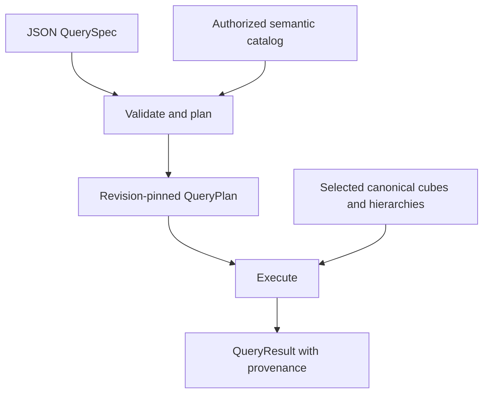

# Universal Data Cube (UDC)

A small, framework-independent TypeScript library for **semantic data integration and declarative OLAP queries**. UDC lets you query measures across datasets by their shared semantic dimensions, reconcile coded members through explicit, versioned concordances, and preserve source provenance for every value.

This is the modern continuation of [Curran Kelleher's original 2014 Universal Data Cube project](https://github.com/curran/udc/tree/gh-pages). The previous AMD/RequireJS version, tests, and annotated documentation are preserved on the historical `gh-pages` branch. The new implementation imports the typed in-memory core and pure golden tests developed in VizHub AI Studio, with provider-neutral snapshot identifiers.

> **Release boundary:** This README describes the repository's source, including the unreleased declarative query API. Published npm versions may not include these features until a subsequent release. UDC contains **no network loader, database, UI, backend API, or VizHub authentication logic**.

## Declarative JSON queries

Ask for **what data you want**, not which datasets to join or which operators
to call. A query names canonical dimensions and measures; UDC resolves the
necessary sources from a catalog supplied by the application.

The query API is inspired by Cube's JSON query format and Apache Druid's
structured arithmetic. Queries are plain, versioned JSON: suitable for saving,
sharing, building in a UI, or generating programmatically.

### 1. Select dimensions and measures

Return observed population by country and year:

```json
{
  "version": 1,
  "dimensions": ["country", "year"],
  "measures": ["population"]
}
```

Dimensions determine the output grain; measures determine the output columns.
The identifiers refer to your semantic catalog, not CSV column names.

### 2. Execute a query

The application supplies canonical cubes (see [creating cubes](#quick-start)).
The following example assumes `populationCube` is a revision-pinned canonical
cube using the identifiers from the bundled population/GDP example.

```ts
import {
  describeQuerySource,
  validateQuery,
  planQuery,
  executeQuery,
} from "@vizhub/udc";
import type { QuerySpec } from "@vizhub/udc";

const query: QuerySpec = {
  version: 1,
  dimensions: ["country", "year"],
  measures: ["population"],
};

const catalog = { sources: [describeQuerySource(populationCube)] };

validateQuery(query);
const plan = planQuery(query, catalog);
const result = executeQuery(plan, { cubes: [populationCube] });

console.log(plan.steps);
console.log(result.observations);
```

For JSON received from an external caller, use `validateQuery` on the decoded
value before planning. The planner can operate on catalog metadata alone,
without loading observation rows. The executor requires exactly the canonical
source snapshots selected by the plan.

Each result observation contains a canonical coordinate, a cell key, and
measure values with provenance. For example, extract the country, year and
numeric population for a chart:

```ts
const rows = result.observations.map((row) => ({
  country: row.coordinate.members.find((m) => m.dimensionId === "country")?.id,
  year: row.coordinate.members.find((m) => m.dimensionId === "year")?.id,
  population: row.values.population?.value,
}));
```

The projection above is for presentation only; the original result retains
source provenance, snapshot identities, and semantic revision information.

### 3. Slice and dice

Select a particular year and country, while retaining both dimensions:

```json
{
  "version": 1,
  "dimensions": ["country", "year"],
  "measures": ["population"],
  "filters": [
    { "dimensionId": "year", "memberIds": ["year:1960"] },
    { "dimensionId": "country", "memberIds": ["country:usa"] }
  ]
}
```

Member IDs are canonical IDs, not display labels or inferred ranges. Multiple
members within a filter are OR-ed; filters across dimensions are AND-ed.
The identifiers here match the bundled example's concordance.

### 4. Aggregate

Keep only the year dimension to sum population across observed countries:

```json
{
  "version": 1,
  "dimensions": ["year"],
  "measures": ["population"]
}
```

Omitted axes are aggregated according to each measure's declared policy
(`sum`, `count`, `average`, or `none`). The empty dimensions array requests
a scalar result. A count aggregation uses the explicit output identity
`measure-id:count`.

Aggregation is over observations present in the selected data, not a guarantee
of complete global coverage. Avoid mixing country and pre-aggregated regional
totals in the source.

### 5. Integrate datasets

Request population and GDP together without naming either physical dataset:

```json
{
  "version": 1,
  "dimensions": ["country", "year"],
  "measures": ["population", "gdp-usd"],
  "filters": [{ "dimensionId": "year", "memberIds": ["year:1960"] }]
}
```

Supply both canonical sources in the catalog:

```ts
const catalog = {
  sources: [
    describeQuerySource(populationCube),
    describeQuerySource(gdpCube),
  ],
};
const plan = planQuery(query, catalog);
const result = executeQuery(plan, { cubes: [populationCube, gdpCube] });
```

Here and in the subsequent examples, `query` is the corresponding JSON
object after validation. UDC resolves the required measures and joins at
equivalent canonical coordinates. The default inner join keeps shared
observations only. Full, left and right joins are also available; directional
joins require a semantic `joinAnchor` measure. Sparse outer-join results
cannot be implicitly aggregated.

### 6. Roll up a hierarchy

Aggregate countries to continents using a host-supplied, versioned geography
hierarchy:

```json
{
  "version": 1,
  "dimensions": ["country", "year"],
  "measures": ["population"],
  "rollups": [
    {
      "hierarchyKey": "geography",
      "revision": "v1",
      "targetMembers": ["africa", "asia", "europe", "americas", "oceania"]
    }
  ]
}
```

This is an illustrative hierarchy contract, not a hierarchy bundled with UDC.
Its target IDs must exist, be disjoint and cover all observed members. Supply
the same approved hierarchy definition in `catalog.hierarchies` and
`inputs.hierarchies`. Roll-up replaces members on the existing country axis;
it does not introduce a new dimension. See [canonical dimension hierarchies](#canonical-dimension-hierarchies).

### 7. Calculate, filter and rank

Find the ten highest observed GDP-per-capita values per year, among countries
with at least one million people, using the two canonical source cubes from
step 5:

```json
{
  "version": 1,
  "dimensions": ["country", "year"],
  "measures": ["gdp-per-capita"],
  "calculatedMeasures": [
    {
      "id": "gdp-per-capita",
      "name": "GDP per capita",
      "unit": "USD/person",
      "expression": {
        "kind": "binary",
        "operator": "/",
        "left": { "kind": "measure", "measureId": "gdp-usd" },
        "right": { "kind": "measure", "measureId": "population" }
      }
    }
  ],
  "measureFilter": {
    "kind": "compare",
    "measureId": "population",
    "operator": "gte",
    "value": 1000000
  },
  "topN": {
    "measureId": "gdp-per-capita",
    "direction": "desc",
    "partitionBy": ["year"],
    "n": 10,
    "ties": "exact"
  }
}
```

Arithmetic is a structured expression tree, never an executable string. The
planner discovers the hidden GDP and population operands even though the output
contains only GDP per capita. Their source provenance remains available.
Derived measures are evaluated after aggregation, so a regional ratio is the
ratio of totals, not an unweighted average of country ratios. Null operands
or division by zero yield null; absent operands in sparse data remain absent.

### How queries work



Execution applies dimension filters, integration, hierarchy roll-ups,
aggregation, calculations, measure filters, top-N and output projection in
that order, skipping unnecessary steps. Ambiguous source providers,
incompatible grains, invalid expressions and stale plans fail with typed errors
rather than being guessed or silently corrected.

The v1 query API supports at most two selected source cubes and one calculated
measure. It does not load data, authorize access, convert units, infer hierarchy
relationships or support arbitrary sorting and chained calculations. The host
must supply authorized, immutable inputs and compatible units. Drill-down and
coverage queries remain available through the lower-level operators.

Read the [complete query language reference](docs/query-language.md) for every
field, the execution contract, resource limits and missing-data semantics.

## Watch the presentation

[](https://youtu.be/69E7t4gpCzk?is=WfK5nyU5v2Ml90Ev)

[**Watch the UDC presentation on YouTube**](https://youtu.be/69E7t4gpCzk?is=WfK5nyU5v2Ml90Ev)

## Start developing

Requires Node.js 22 or newer.

```bash
npm install
npm run check
npm run example
```

The example loads bundled sample CSVs for UN population, World Bank GDP, and country-code concordances and prints joined observations. No VizHub server or credentials are required.

After npm publication, application consumers can install `@vizhub/udc` and import its named functions.

## Quick start

UDC accepts structured rows, not raw CSV/TSV files. Parsing is the caller's responsibility; the published library has no production dependencies.

```ts
import { createCube } from "@vizhub/udc";

// The host application supplies already-parsed rows.
const rows = [{ country: "CHN", year: "1960", population: "650680114" }];

const cube = createCube(
  rows,
  {
    id: "population-schema",
    revision: "v1",
    dimensions: [
      {
        field: "country",
        dimension: { id: "country", name: "Country" },
        codelist: { id: "iso-alpha3", revision: "v1" },
      },
      {
        field: "year",
        dimension: { id: "year", name: "Year" },
        codelist: { id: "calendar-year", revision: "v1" },
      },
    ],
    measures: [
      {
        field: "population",
        measure: {
          id: "population",
          name: "Population",
          unit: "persons",
          aggregation: "sum",
        },
        scale: 1,
      },
    ],
  },
  { datasetId: "population-1960", revision: "v1" },
);
```

`createCube` produces a **SourceCube** with coded coordinates; `canonicalizeCube` yields a **CanonicalCube**; and `aggregateCube` yields a distinct **AggregatedCube** stage that cannot be mistaken for single-source data. To combine sources, build a concordance from explicitly verified exact mappings, call `canonicalizeCube` on both source cubes, then `integrateCubes`. See [the runnable population/GDP example](examples/population-gdp.mjs) for the complete workflow.

## Operations

| Function                                                      | Purpose                                                                         |
| ------------------------------------------------------------- | ------------------------------------------------------------------------------- |
| `createCube(rows, schema, snapshot)`                          | Create a typed SourceCube with measure provenance                               |
| `codedRef`, `canonicalMember`, `memberIdentity`, `getCellKey` | Portable and order-invariant coordinate identities                              |
| `validateSemanticSchema(schema, columns?)`                    | Validate schema mappings, IDs, and field coverage                               |
| `resolveConcordance(mappings, context)`                       | Verified exact-equivalence closure with conflicts                               |
| `canonicalizeCube(source, concordance)`                       | Translate coded coordinates to canonical member identities                      |
| `integrateCubes(a, b, { join })`                              | Inner (default), left, right, or full joins at identical canonical grain        |
| `aggregateCube(cube, retainDimensionIds)`                     | Explicit roll-ups honoring each measure's `sum`/`count`/`average`/`none` policy |
| `sliceCube(cube, member)`                                     | Select a member and remove its dimension                                        |
| `projectDatasetCoverage(source, dimensions)`                  | Project and deduplicate canonical coordinates for one dataset                   |
| `countDatasetCoverage(datasets, dimensions)`                  | Count distinct dataset IDs at projected coordinates across bounded inputs       |
| `createHierarchy(definition)`                                 | Validate a named, versioned canonical member forest; find parents/ancestors     |

### OLAP query operators

- `diceCube(cube, selections)` filters by canonical member sets (OR within an axis, AND across axes), retaining dimensions and provenance. Empty selections match all; an empty member set matches none.
- `rollupCube(cube, hierarchy, targetMembers)` replaces members on one axis with their selected ancestors and aggregates using the existing measure policies. Targets must be disjoint and cover all observed members. Sparse inputs and mixed ancestor/descendant grains are rejected.
- `calculateMeasure(cube, definition)` evaluates a bounded arithmetic expression at each coordinate. The result is a distinct, terminal calculated stage with operand provenance. Calculate ratios after roll-up, not before.

- `drilldownCube(fineCube, hierarchy, parentMemberId)` expands a parent into observed immediate-child totals from finer-grained data.
- `filterCube(cube, predicate)` applies bounded numeric and boolean predicates, distinguishing null from absent measures.
- `rankCube(cube, options)` returns non-aggregatable ranking metadata with optional dimension partitions.
- `topNCube(cube, options)` selects top or bottom observations per partition with explicit cutoff tie semantics. Filtering, dice, ranking and top-N also support calculated cubes.

See [OLAP examples and contracts](docs/olap.md).

For the high-level interface that composes these operators, see [declarative JSON queries](#declarative-json-queries).

### Canonical dimension hierarchies

`createHierarchy` accepts **explicit canonical member edges**, not inferred
geographic or industry relations. One named hierarchy is a single-parent,
acyclic forest within one dimension. Distinct classification systems use
distinct hierarchy keys.

```ts
import { canonicalMember, createHierarchy } from "@vizhub/udc";

const hierarchy = createHierarchy({
  key: "un-m49",
  dimensionId: "space",
  revision: "source-snapshot:v1",
  edition: "2026",
  edges: [
    {
      child: canonicalMember("space", "india"),
      parent: canonicalMember("space", "southern-asia"),
      provenance: {
        snapshot: { datasetId: "geography-2026", revision: "v1" },
        sourceRow: 1,
        mappingRevision: "approval:v1",
      },
    },
  ],
});

hierarchy.parent("india")?.id; // "southern-asia"
hierarchy.ancestors("india").map((member) => member.id);
```

Identical child-to-parent edges deduplicate while preserving each distinct
source-row provenance. Cycles, self-parents, conflicting parents, cross-dimension
identities and invalid revisions are rejected. Hosts must provide approved
relationships and stable canonical IDs; UDC neither authorizes nor materializes
member records. The hierarchy module itself does **not** perform cube rollups or source-code
translation; use the separate OLAP operators for cube queries. See [the hierarchy API](docs/api.md) and [semantics](docs/concepts.md).

Inner joins return dense `CanonicalCube` values as before. Left/right/full joins return a distinct `SparseIntegratedCube`: `presence.left` and `presence.right` identify which source observed each coordinate. A source absent at a coordinate has **no measure property**; a present source reporting a null has a measure property whose `value` is `null`. Sparse results may be sliced, but cannot be implicitly aggregated or passed back as canonical input.

Coverage is separate from numeric integration. `projectDatasetCoverage` accepts a single-snapshot `CanonicalCube` or measure-less `CanonicalCoordinateDataset`, retains only selected canonical axes, and deduplicates coordinates within the dataset. `countDatasetCoverage` counts each dataset identity only once per coordinate, even when many source rows or visualization uses refer to the same dataset. It returns exact contributing dataset IDs for traceability. No Cartesian-product cells, inferred year coverage, implicit rollups, or numeric values are created.

The implementation deliberately rejects unknown or non-equivalent identifiers, duplicate measure identities, incompatible grains, ambiguous mappings and over-budget operations. There is no guesswork or implicit aggregation.

Failures throw a typed `UdcError` carrying a `UdcErrorCode` (`INVALID`, `LIMIT`, `DUPLICATE`, `UNRESOLVED`, `CONFLICT`, `INCOMPATIBLE`). `UDC_LIMITS` exposes the resource ceilings; inputs over budget fail rather than truncate. Low-level `assertId` and `assertBound` raise the same errors.

## Documentation

- [Quick start](docs/quickstart.md)
- [Concepts and data model](docs/concepts.md)
- [Declarative query language](docs/query-language.md)
- [OLAP operators and contracts](docs/olap.md)
- [API reference](docs/api.md)
- [Scope, limits, and security](docs/limitations.md)
- [Migrating from UDC 2014](docs/migration-from-2014.md)
- [Contributing](CONTRIBUTING.md) · [Security reporting](SECURITY.md) · [Change log](CHANGELOG.md)

## Relationship to VizHub

UDC is useful without VizHub. Visualization and data platforms may supply their own CSV/TSV bytes, schema revisions, reviewed mappings and provenance. In VizHub AI Studio, authorization, project membership and registry-source access must remain in the hosting application; the standalone library **does not perform authorization**. A source hash is an identity, not an access token.

UDC is MIT-licensed. See [LICENSE](LICENSE) and [NOTICE.md](NOTICE.md).
